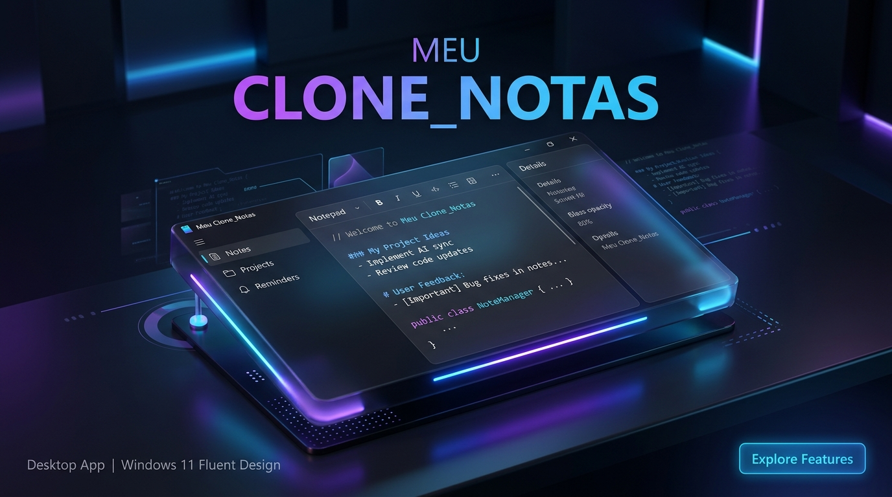

<div align="center">

# ⚡ Meu Clone_Notas ⚡
### Engenharia Reversa & Recriação Fidedigna do Bloco de Notas do Windows

[](LICENSE)
[](https://github.com/emersonnjsantos/clone_bloco_notas)
[](https://github.com/emersonnjsantos/clone_bloco_notas)
[](https://github.com/emersonnjsantos/clone_bloco_notas)

<br/>



<br/><br/>

> **"Uma recriação cirúrgica do aplicativo mais clássico do Windows, fruto de engenharia reversa de baixo nível combinada com design moderno de ponta."**

[Instalação Rápida](#-instalação-e-uso-no-windows) •
[Engenharia Reversa](#-relatório-de-engenharia-reversa) •
[Recursos](#-recursos-e-funcionalidades) •
[Arquitetura](#-arquitetura-do-projeto) •
[Atalhos](#-tabela-de-atalhos-suportados)

</div>

---

## 🌟 Sobre o Projeto

O **Meu Clone_Notas** não é apenas mais um editor de texto simples: é um projeto completo de **engenharia reversa e desenvolvimento de software nativo**. 

O ponto de partida foi o binário oficial do sistema operacional Windows localizado em `C:\Windows\System32\notepad.exe`. A partir de técnicas de inspeção de formato Portable Executable (PE32+), desmontagem de recursos bilíngues (MUI) e mapeamento das APIs de baixo nível do subsistema Win32, o comportamento exato de renderização, ciclo de vida e atalhos foi catalogado e reimplementado em duas frentes:
1. **Aplicativo Desktop Executável (`.exe`)**: com instalador automático para a Área de Trabalho e Menu Iniciar.
2. **Aplicação Web Moderna**: com zero dependências e suporte a múltiplos navegadores.

---

## 🔬 Relatório de Engenharia Reversa

A análise estática e de recursos foi realizada diretamente sobre o binário original e documentada em [relatorio_engenharia_reversa.md](relatorio_engenharia_reversa.md).

### 🔍 Resumo Técnico das Descobertas:
```yaml
Binário Alvo: C:\Windows\System32\notepad.exe
Formato: PE32+ (x86_64 Executável Nativo do Windows)
Hash SHA-256: 468ffe129c395abf6b21a09efdf261910a95fb98aa982ead73caa7b2b684577e
Tamanho Original: 360.448 bytes (352 KB)
Build Identificado: 10.0.26100.8875 (WinBuild.160101.0800)
```

| Subsistema Observado | Bibliotecas Extraídas | Comportamento Reconstruído no Clone |
| :--- | :--- | :--- |
| **Janelas & Mensagens** | `USER32.dll` (`CreateWindowExW`, `DefWindowProcW`, `WM_COMMAND`) | Loop de eventos, gerenciamento de janelas filhas, suporte a DPI. |
| **Renderização de Texto** | `GDI32.dll` (`CreateFontIndirectW`, `GetTextMetricsW`) | Fontes autênticas (`Consolas`, `Segoe UI`, `Cascadia Code`), métricas tipográficas. |
| **Barra de Status** | `COMCTL32.dll` (`CreateStatusWindowW`) | 4 seções fixas: Posição do cursor, Zoom %, CRLF/LF e Codificação UTF-8. |
| **Localização & Menus** | `notepad.exe.mui` (pt-BR / en-US) | Extração integral da árvore `RT_MENU`, aceleradores `RT_ACCELERATOR` e diálogos `RT_DIALOG`. |
| **Ícones do Sistema** | `RT_GROUP_ICON` (ID 25) | Ícone oficial de 256x256 e pacote `.ico` com 13 resoluções extraído sem perdas. |

---

## 🎯 Recursos e Funcionalidades

### 🖥️ Interface Fluent & Experiência Windows 11
- **Sistema de Abas Moderno:** trabalhe com vários documentos abertos em abas dinâmicas (`Ctrl+T` para nova aba, `Ctrl+W` para fechar).
- **Tema Escuro & Claro:** alterne instantaneamente com um clique ou siga a paleta de cores Fluent do Windows.
- **Internacionalização em Tempo Real:** suporte a **Português (pt-BR)** e **Inglês (en-US)** com base nos arquivos MUI oficiais.
- **Barra de Título Customizada:** com ícone autêntico, título reativo (`*` para arquivos modificados) e controles nativos de janela.

### 📝 Edição de Texto Completa
- **Word Wrap (Quebra de Linha Automática):** alternância instantânea com recálculo dinâmico de barras de rolagem.
- **Zoom Inteligente:** ampliação suave via `Ctrl + +`, `Ctrl + -`, `Ctrl + 0` e atalho de rolagem do mouse `Ctrl + Wheel`.
- **Busca e Substituição Nativas:**
  - *Localizar (`Ctrl+F`):* suporte a busca progressiva, direção (cima/baixo), diferenciar maiúsculas/minúsculas e ciclo (wrap around).
  - *Substituir (`Ctrl+H`):* substituição unitária e total com relatório de ocorrências encontradas.
  - *Ir Para Linha (`Ctrl+G`):* navegação direta para qualquer linha do documento.
- **Inserção de Data e Hora (`F5`):** carimbo de data e hora formatado no padrão local.
- **Pesquisa com o Bing (`Ctrl+E`):** pesquisa rápida na web para termos selecionados.
- **Diálogo de Fonte Completo:** escolha de famílias tipográficas, estilo (Normal, Negrito, Itálico), tamanho e pré-visualização ao vivo.
- **Impressão Limpa (`Ctrl+P`):** folha de estilo de impressão que oculta menus e foca unicamente no conteúdo textual.

---

## 🚀 Instalação e Uso no Windows

Você pode executar o **Meu Clone_Notas** de três formas simples:

### Opção 1: Executável Direto (.exe)
Basta dar dois cliques no arquivo:
```powershell
D:\CLONE_MODELO\BlocoDeNotas.exe
```
> *O executável é compilado em C nativo com o ícone do Bloco de Notas embutido e inicializa o aplicativo sem telas pretas de terminal.*

### Opção 2: Instalador com 1 Clique (Área de Trabalho & Menu Iniciar)
Execute o instalador automático:
```powershell
Instalar.bat
```
- Cria o atalho oficial na sua **Área de Trabalho**.
- Cria o atalho oficial no **Menu Iniciar** do Windows.
- Para desinstalar os atalhos a qualquer momento, execute `Desinstalar.bat`.

### Opção 3: Modo Web (Navegador)
Caso queira utilizar no navegador:
```bash
npm run web
# ou
node server.js
```
Acesse em: `http://localhost:3000`

---

## 📂 Arquitetura do Projeto

```plaintext
D:\CLONE_MODELO/
├── 📄 BlocoDeNotas.exe              # Executável de inicialização rápida com ícone embutido
├── ⚙️ Instalar.bat                  # Script de instalação de atalhos no Windows
├── ⚙️ Desinstalar.bat               # Script de remoção limpa de atalhos
├── 📄 Instalar.ps1                  # Lógica PowerShell para registro no Menu Iniciar/Desktop
├── 🌐 index.html                    # Estrutura semântica completa e caixas de diálogo
├── 🎨 style.css                     # Design System Fluent UI (Dark/Light Mode)
├── 🧠 app.js                        # Núcleo reativo do editor, atalhos e controle de abas
├── 🖥️ main.js                       # Processo principal do Electron para modo desktop nativo
├── 🚀 server.js                     # Servidor HTTP nativo Node.js (zero dependências)
├── 🖼️ banner_clone_notas.png        # Banner oficial em alta resolução
├── 🖼️ notepad_icon.png              # Ícone oficial extraído de notepad.exe (256x256 PNG)
├── 🖼️ notepad_icon.ico              # Pacote de ícones ICO nativo (13 resoluções)
├── ⚙️ launcher.c & launcher.rc      # Código-fonte em C e recursos do launcher nativo
├── 🔬 extract_notepad_info.js       # Script de extração de seções e imports do PE
├── 🔬 extract_icon.js               # Script extrator de recursos RT_GROUP_ICON
├── 📊 relatorio_engenharia_reversa.md # Dossiê completo da engenharia reversa
└── 📦 package.json                  # Metadados e scripts npm
```

---

## ⌨️ Tabela de Atalhos Suportados

| Atalho | Ação Executada |
| :---: | :--- |
| <kbd>Ctrl</kbd> + <kbd>N</kbd> | Novo Documento |
| <kbd>Ctrl</kbd> + <kbd>Shift</kbd> + <kbd>N</kbd> | Nova Janela |
| <kbd>Ctrl</kbd> + <kbd>T</kbd> | Nova Guia (Aba) |
| <kbd>Ctrl</kbd> + <kbd>W</kbd> | Fechar Guia Atual |
| <kbd>Ctrl</kbd> + <kbd>O</kbd> | Abrir Arquivo Local |
| <kbd>Ctrl</kbd> + <kbd>S</kbd> | Salvar Arquivo |
| <kbd>Ctrl</kbd> + <kbd>Shift</kbd> + <kbd>S</kbd> | Salvar Como... |
| <kbd>Ctrl</kbd> + <kbd>P</kbd> | Imprimir Documento |
| <kbd>Ctrl</kbd> + <kbd>F</kbd> | Localizar Texto |
| <kbd>F3</kbd> / <kbd>Shift</kbd> + <kbd>F3</kbd> | Localizar Próxima / Anterior |
| <kbd>Ctrl</kbd> + <kbd>H</kbd> | Substituir Texto |
| <kbd>Ctrl</kbd> + <kbd>G</kbd> | Ir Para a Linha |
| <kbd>F5</kbd> | Inserir Hora e Data |
| <kbd>Ctrl</kbd> + <kbd>+</kbd> / <kbd>-</kbd> / <kbd>0</kbd> | Ampliar / Reduzir / Restaurar Zoom |
| <kbd>Ctrl</kbd> + <kbd>E</kbd> | Buscar Termo Selecionado no Bing |

---

<div align="center">
  <sub>Construído com dedicação, engenharia reversa e paixão por software bem trabalhado. ⭐ Não esqueça de deixar uma estrela no repositório!</sub>
</div>
